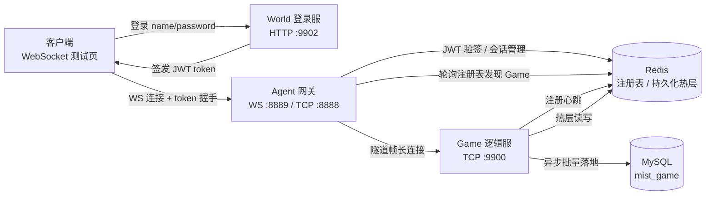

# mist

基于 Go 与 Actor 模型的分布式游戏服务器框架：网关（agent）、逻辑服（game）、外部服务（world）分层解耦，支持服务注册发现与分层持久化。

## 架构图

## 技术栈

| 分类 | 选型 | 用途 | 性能与设计特性 |
| --- | --- | --- | --- |
| 语言 | Go 1.25 | 三个独立 module（game/agent/world），agent 与 world 通过 replace 依赖 game 公共包 | goroutine 轻量并发，支撑高连接密度 |
| 客户端接入 | WebSocket（nhooyr.io/websocket） | 玩家与网关长连接 | 全双工长连接，帧级低开销 |
| 外部服务 | HTTP（net/http） | world 登录 / 健康检查 | 无状态服务，天然可水平扩展 |
| 内部 RPC | gRPC | game 业务 RPC | HTTP/2 多路复用 + Protobuf 二进制编码 |
| 注册中心 / 缓存 | Redis（go-redis/v8） | 服务注册发现、持久化热层、玩家信息 | 内存级读写，热数据就近访问 |
| 持久化 | MySQL（go-sql-driver + sqlx） | 玩家数据最终落库 | 批量 upsert 异步落地，减少 IO 往返 |
| 鉴权 | JWT（golang-jwt/v5） | world 签发、agent 验签 | 网关一次性验签，业务链路零鉴权开销 |
| 协议编解码 | Protobuf | 客户端协议消息 | 紧凑二进制编码，带宽与 CPU 开销低 |

**性能设计取向**：玩家消息主链路全程无锁串行处理，杜绝并发竞争；网络 IO 与持久化全部异步化——写队列缓冲 + 独立协程批量落库，热路径不被磁盘与网络延迟阻塞；消息协议采用紧凑二进制编码，最大限度降低带宽与 CPU 消耗，支撑低延迟、高吞吐的在线业务场景。

## 核心思想

1. **Actor 模型与串行调度**：以玩家/业务单元为粒度构建 Actor，消息队列串行处理，保证单 Actor 内无并发；状态机（运行/休眠/关闭）由中央管理器调度，空闲休眠、超时回收，连接断开与 Actor 生命周期解耦；单 Actor panic 隔离，handler 超时视为故障并踢线，确保崩溃不影响进程。

2. **网关无状态分层**：Agent 网关仅负责握手验签（一次性 JWT 校验）与纯字节转发，不承载业务逻辑；Game 逻辑服仅监听内网地址，安全边界收敛在网关。

3. **长连接多路复用**：Agent 与每个 Game 建立一条长连接，通过 tunnelID 隧道帧承载多个玩家会话，避免按玩家建连的资源开销。

4. **服务注册与发现**：Game 启动后向 Redis 注册自身地址并心跳续期，Agent 轮询注册表动态发现可用 Game 并维护长连接，支持多 Game 横向扩展。

5. **分层持久化（写回缓存）**：Actor 内存数据经脏标记在消息循环内序列化，入异步写队列后由独立协程写入 Redis 热层，再由 DB 协程批量落地 MySQL；加载路径 Redis → MySQL 回源，兼顾读写性能与可靠性。
